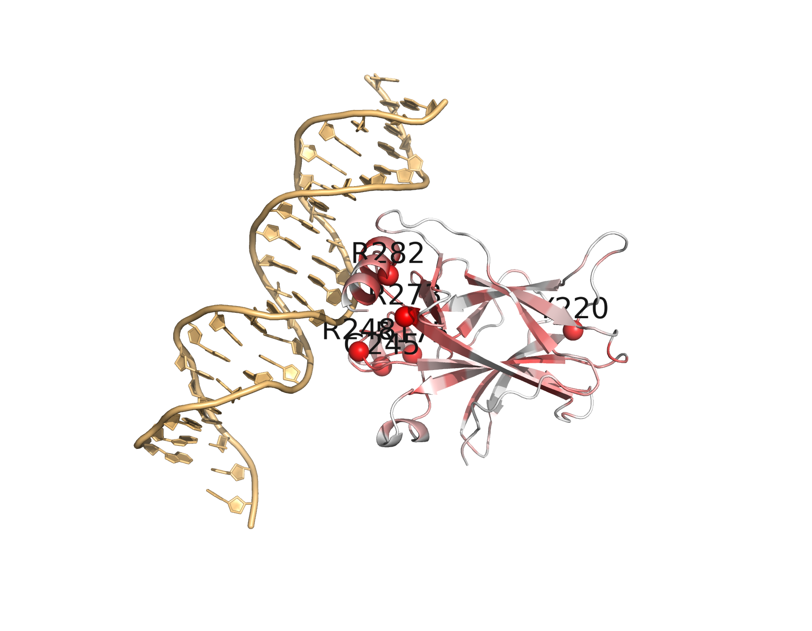
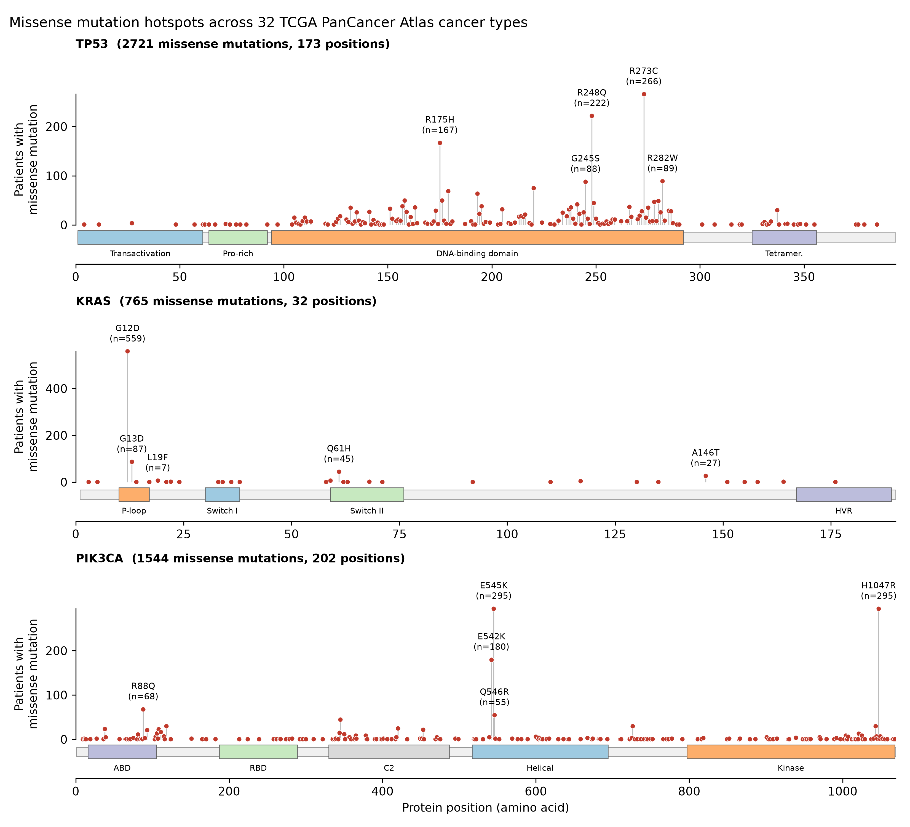
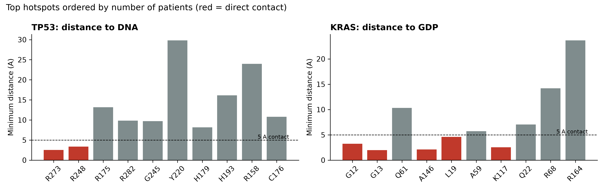
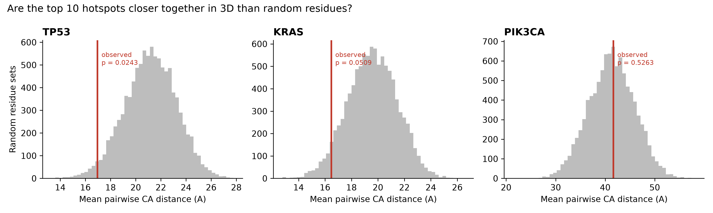
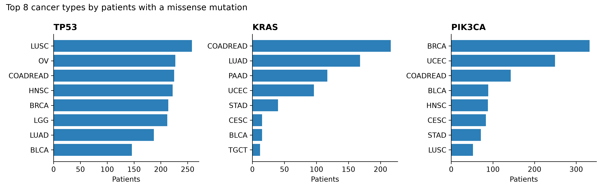
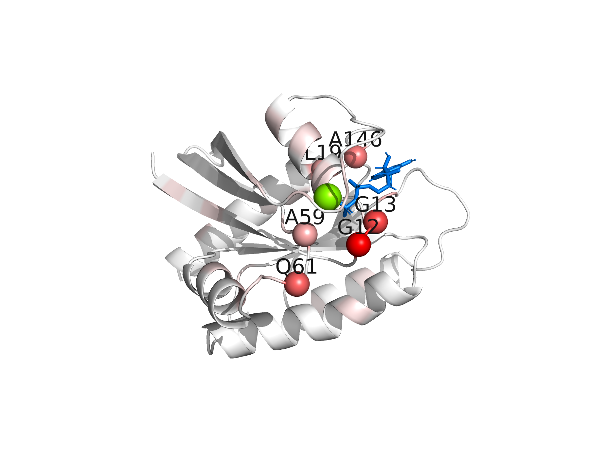
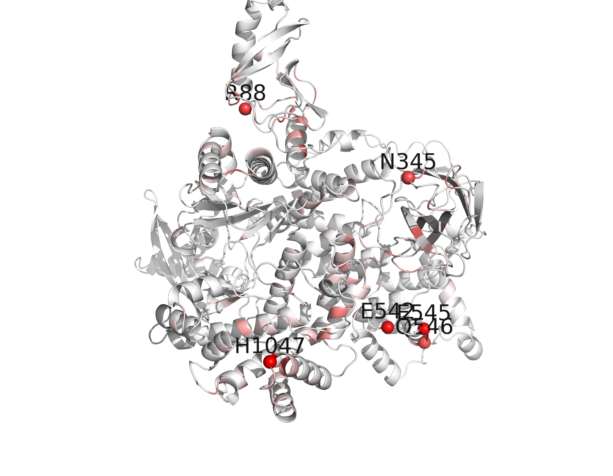

# Where Do Cancer Mutations Sit in 3D? Structural Mapping of TP53, KRAS and PIK3CA Hotspots

**Independent reanalysis of public data** · Md. Abrar Faiyaj · October 2026


<p align="center">
  
  <br><em>TP53 bound to DNA (PDB 1TSR), coloured by how many patients carry a mutation at each residue (white = none, red = most).</em>
</p>

Cancer genomes carry thousands of mutations, but only a few drive the disease. This project asks a simple question:

> **Do cancer mutations in TP53, KRAS and PIK3CA fall at random positions, or do they cluster in specific 3D regions that control each protein's function?**

I combined tumor mutation data from **32 cancer types (TCGA PanCancer Atlas)** with **3D protein structures (PDB and AlphaFold)** to locate mutation hotspots, test whether they cluster in 3D, and measure how close they sit to each protein's functional partner (DNA for TP53, the nucleotide GDP for KRAS).



---

## Key findings

**1. Oncogene vs. tumor suppressor: two different mutation patterns.**
KRAS (an oncogene) has 765 missense mutations at only **32 positions**, and 73% of them are at a single residue, G12. TP53 (a tumor suppressor) has 2,721 missense mutations spread over **173 positions** across its DNA-binding domain. An oncogene must be *switched on* by a few specific changes, while a tumor suppressor can be *broken* in many ways.

| Gene | Missense mutations | Positions hit | Top hotspots (patients) |
|---|---|---|---|
| TP53 | 2,721 | 173 | R273 (266), R248 (222), R175 (167), R282 (89), G245 (88) |
| KRAS | 765 | 32 | G12 (559), G13 (87), Q61 (45), A146 (27) |
| PIK3CA | 1,544 | 202 | H1047 (295), E545 (295), E542 (180), R88 (68), Q546 (55) |

**2. TP53 has two kinds of hotspot: DNA-contact and structural.**
In the p53–DNA structure (PDB 1TSR), **R273 (2.5 Å) and R248 (3.4 Å)** touch the DNA directly. **R175 (13 Å), Y220 (30 Å), and the zinc-binding residues C176 and H179** sit away from the DNA; these mutations are expected to work by disrupting the protein's fold rather than its DNA contact.

**3. KRAS hotspots surround the nucleotide pocket.**
**G12 (3.2 Å), G13 (2.0 Å) and A146 (2.1 Å)** directly contact GDP. Q61 is 10 Å away in this GDP-bound ("off") structure, consistent with its known role in the GTP-bound ("on") state.



**4. TP53 and KRAS hotspots cluster in 3D; PIK3CA hotspots do not.**
The 5 most mutated residues are ~35% closer together than random residue sets in TP53 (p = 0.013) and KRAS (p = 0.018) (permutation test, 10,000 random sets). PIK3CA shows no clustering (ratio ≈ 1.0) because its hotspots fall in **two distant domains**: the helical domain (E542K, E545K) and the kinase domain (H1047R). These are two different routes to activating the same protein.

| Gene | Top-K | Observed mean distance (Å) | Random (Å) | Ratio | p-value |
|---|---|---|---|---|---|
| TP53 | 5 | 13.3 | 21.2 | 0.63 | 0.013 |
| TP53 | 10 | 17.0 | 21.2 | 0.80 | 0.024 |
| KRAS | 5 | 12.8 | 19.5 | 0.65 | 0.018 |
| KRAS | 10 | 16.5 | 19.6 | 0.84 | 0.051 |
| PIK3CA | 5 | 40.6 | 41.4 | 0.98 | 0.46 |
| PIK3CA | 10 | 41.7 | 41.3 | 1.01 | 0.53 |



**5. Links to therapy.**
- **KRAS G12C** (101 patients here) is the target of approved covalent inhibitors (sotorasib, adagrasib). **G12D**, the most common variant (197 patients), has been much harder to drug.
- **TP53 Y220C** (75 patients) creates a surface cavity that destabilises the protein; small molecules that fill this pocket and restore p53 folding have reached clinical testing.

**6. Cancer types.** KRAS mutations concentrate in colorectal, lung and pancreatic cancer; PIK3CA mutations in breast and endometrial cancer; TP53 mutations are frequent across almost all types.



### 3D views

| TP53 + DNA | KRAS + GDP | PIK3CA (AlphaFold) |
|---|---|---|
|  |  |  |

Interactive, rotatable versions are in [`results/interactive/`](results/interactive/). Download one and open it in a browser.

---

## Methods

1. **Mutations** (`scripts/01_get_mutations.py`): missense mutations in TP53, KRAS and PIK3CA were downloaded from all 32 TCGA PanCancer Atlas studies through the cBioPortal API. Each patient was counted once per residue.
2. **Lollipop plots** (`scripts/02_lollipop_plot.py`): mutation counts per position, with domain boundaries approximated from UniProt (P04637, P01116, P42336), and the exact amino-acid changes at each hotspot (`results/hotspot_variants.csv`).
3. **Structure mapping** (`scripts/03_map_to_structure.py`):
   - Structures: TP53 = PDB 1TSR (the chain with the most DNA contacts, chain B); KRAS = PDB 4OBE (wild-type, GDP-bound, chain A); PIK3CA = AlphaFold model AF-P42336.
   - Counts were written to the B-factor column, and each residue's minimum atom distance to DNA or GDP was computed.
   - Images were rendered with PyMOL, and interactive views were made with 3Dmol.js.
4. **Statistics** (`scripts/04_structure_stats.py`):
   - Clustering: the mean pairwise Cα distance of the top-K hotspots was compared against 10,000 random residue sets from the same structure. For AlphaFold, only residues with pLDDT ≥ 70 were used.
   - Contact: a hotspot was called "contact" if any atom is within 5 Å of DNA or GDP.

## Tools used

| Tool | Purpose in this project |
|---|---|
| **Python 3.11** | Main language for all four scripts |
| **cBioPortal REST API + Requests** | Download tumor mutations for each gene from 32 TCGA studies |
| **pandas / NumPy** | Clean mutation tables, count patients per residue, compute distances and run the permutation test |
| **Matplotlib** | Lollipop plots, cancer-type bar charts, clustering and distance figures |
| **Biopython (Bio.PDB)** | Read PDB/AlphaFold structures, pick the DNA-bound chain, measure residue distances, write mutation counts into B-factors |
| **RCSB PDB / AlphaFold DB** | Experimental structures (1TSR, 4OBE) and the predicted PIK3CA model |
| **PyMOL (open-source)** | Render the 3D structure images coloured by mutation frequency |
| **3Dmol.js** | Interactive, rotatable 3D views in the browser |
| **Conda** | Reproducible software environment (`environment.yml`) |
| **Git / GitHub (+ GitHub CLI)** | Version control and public sharing of code and results |
| **WSL2 (Ubuntu on Windows)** | Linux environment where the analysis was run |

## Limitations

- **Single, static structures.** KRAS is shown in the GDP ("off") state, and TP53 shows only the DNA-binding domain (it covers 97% of TP53 missense mutations).
- **PIK3CA is modelled alone.** In the cell it binds the regulatory subunit p85, and the helical-domain hotspots act at that interface, which this model does not include.
- **Raw counts only.** Hotspots are ranked by raw patient counts, with no correction for background mutation rate or protein length. All data come from one cohort (TCGA).
- **Modest p-values** from one test statistic. Results are consistent with known biology but are exploratory.

## How to run

```bash
conda env create -f environment.yml
conda activate cancer3d
python scripts/01_get_mutations.py
python scripts/02_lollipop_plot.py
python scripts/03_map_to_structure.py
python scripts/04_structure_stats.py
```
Run from the project root. Structures are downloaded automatically (except `structures/1TSR.pdb`: `wget -P structures/ https://files.rcsb.org/download/1TSR.pdb`).

```
├── scripts/              # 01–04, run in order
├── data/raw/             # mutations per gene (all types)
├── data/processed/       # missense counts per residue
├── structures/           # 1TSR, 4OBE, AlphaFold PIK3CA
├── results/
│   ├── figures/          # all plots and 3D images
│   ├── interactive/      # rotatable 3D HTML pages
│   ├── structures/       # PDBs with mutation counts in B-factor
│   └── *.csv             # hotspot, clustering and distance tables
└── environment.yml
```

## References

**Mutation data**
1. Cerami E, et al. The cBio Cancer Genomics Portal: an open platform for exploring multidimensional cancer genomics data. *Cancer Discovery*. 2012;2(5):401–404. doi:[10.1158/2159-8290.CD-12-0095](https://doi.org/10.1158/2159-8290.CD-12-0095)
2. Gao J, et al. Integrative analysis of complex cancer genomics and clinical profiles using the cBioPortal. *Science Signaling*. 2013;6(269):pl1. doi:[10.1126/scisignal.2004088](https://doi.org/10.1126/scisignal.2004088)
3. de Bruijn I, et al. Analysis and visualization of longitudinal genomic and clinical data from the AACR Project GENIE Biopharma Collaborative in cBioPortal. *Cancer Research*. 2023;83(23):3861–3867. doi:[10.1158/0008-5472.CAN-23-0816](https://doi.org/10.1158/0008-5472.CAN-23-0816)
4. Hoadley KA, et al. Cell-of-origin patterns dominate the molecular classification of 10,000 tumors from 33 types of cancer. *Cell*. 2018;173(2):291–304.e6. doi:[10.1016/j.cell.2018.03.022](https://doi.org/10.1016/j.cell.2018.03.022)
5. Ellrott K, et al. Scalable open science approach for mutation calling of tumor exomes using multiple genomic pipelines. *Cell Systems*. 2018;6(3):271–281.e7. doi:[10.1016/j.cels.2018.03.002](https://doi.org/10.1016/j.cels.2018.03.002)

**Protein structures and annotations**

6. Cho Y, Gorina S, Jeffrey PD, Pavletich NP. Crystal structure of a p53 tumor suppressor–DNA complex: understanding tumorigenic mutations. *Science*. 1994;265(5170):346–355. doi:[10.1126/science.8023157](https://doi.org/10.1126/science.8023157) (PDB [1TSR](https://www.rcsb.org/structure/1TSR))
7. Hunter JC, et al. In situ selectivity profiling and crystal structure of SML-8-73-1, an active site inhibitor of oncogenic K-Ras G12C. *PNAS*. 2014;111:8895–8900. doi:[10.1073/pnas.1404639111](https://doi.org/10.1073/pnas.1404639111) (PDB [4OBE](https://www.rcsb.org/structure/4OBE))
8. Jumper J, et al. Highly accurate protein structure prediction with AlphaFold. *Nature*. 2021;596(7873):583–589. doi:[10.1038/s41586-021-03819-2](https://doi.org/10.1038/s41586-021-03819-2)
9. Bertoni D, et al. AlphaFold Protein Structure Database 2025: a redesigned interface and updated structural coverage. *Nucleic Acids Research*. 2026;54(D1):D358–D362. doi:[10.1093/nar/gkaf1226](https://doi.org/10.1093/nar/gkaf1226) (model [AF-P42336-F1](https://alphafold.ebi.ac.uk/entry/P42336), v6)
10. The UniProt Consortium. UniProt: the Universal Protein Knowledgebase in 2025. *Nucleic Acids Research*. 2025;53(D1):D609–D617. doi:[10.1093/nar/gkae1010](https://doi.org/10.1093/nar/gkae1010)

**Software**

11. Cock PJA, et al. Biopython: freely available Python tools for computational molecular biology and bioinformatics. *Bioinformatics*. 2009;25(11):1422–1423. doi:[10.1093/bioinformatics/btp163](https://doi.org/10.1093/bioinformatics/btp163)
12. Rego N, Koes D. 3Dmol.js: molecular visualization with WebGL. *Bioinformatics*. 2015;31(8):1322–1324. doi:[10.1093/bioinformatics/btu829](https://doi.org/10.1093/bioinformatics/btu829)
13. The PyMOL Molecular Graphics System (open-source build). Schrödinger, LLC.

## Author

Md Abrar Faiyaj, M.S. in Biotechnology, BRAC University
